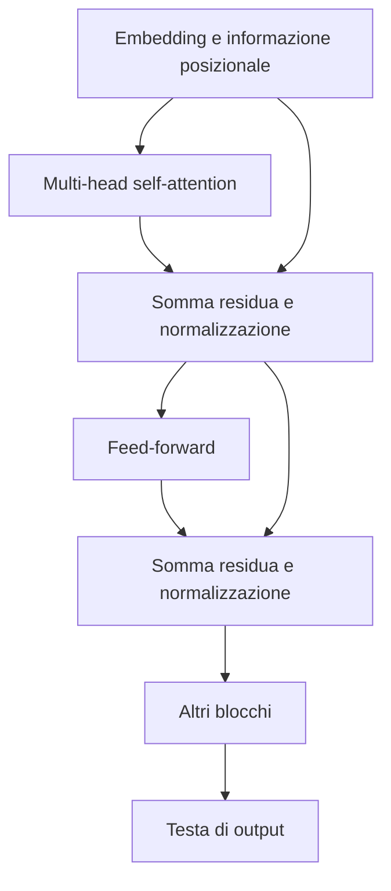

# Architettura Transformer e meccanismo di attenzione

Capitolo: [[Architettura Transformer e Foundation Models]]

Il **Transformer** è un'architettura neurale che elabora sequenze collegando le informazioni presenti nelle diverse posizioni. Nel testo, questo permette di rappresentare ciascun elemento tenendo conto della frase in cui compare. Il meccanismo che costruisce questi collegamenti è l'**attenzione**.

## Il problema: una parola va interpretata nel suo contesto

Consideriamo «Il gatto dorme». La parola «dorme» indica un'azione, ma per sapere chi la compie serve collegarla a «gatto». In «Il bambino dorme» la parola è identica, mentre cambia il soggetto. La rete deve quindi ottenere una rappresentazione di «dorme» che incorpori informazioni diverse nei due casi.

Le [[Recurrent Neural Networks]] trasportano informazioni aggiornando uno stato lungo la sequenza. Nel Transformer, l'attenzione permette invece a una posizione di ricevere direttamente informazioni dalle posizioni che può consultare, anche lontane. Questo evita di dover trasferire ogni collegamento attraverso tutti gli stati intermedi di una ricorrenza.

## Preparare il testo: token, vettori e posizione

Prima di calcolare questi collegamenti, occorre trasformare il testo in numeri. Il **tokenizer** divide la frase in **token**, che possono essere parole, parti di parole o simboli. Per seguire l'esempio, supponiamo una divisione in tre token: «Il», «gatto», «dorme». È una semplificazione didattica: la segmentazione effettiva dipende dal tokenizer.

A ogni token viene assegnato un identificativo nel vocabolario. Il modello lo usa per recuperare un **embedding**, cioè un vettore numerico appreso. L'identificativo serve a trovare il vettore: due identificativi vicini non indicano significati simili. L'embedding iniziale verrà poi aggiornato dai blocchi del modello, diventando una rappresentazione dipendente dal contesto.

Serve anche sapere dove compare ciascun token. «Il cane insegue il gatto» e «Il gatto insegue il cane» contengono le stesse parole, ma hanno significati diversi. Il Transformer originale aggiunge agli embedding una **codifica posizionale** basata su seno e coseno; altre architetture usano posizioni apprese, relative o rotazioni dei vettori. Il requisito comune è rendere disponibile l'ordine della sequenza.

## Che cosa fa concretamente l'attenzione

Per aggiornare «dorme», il modello calcola quanto far contribuire le informazioni di ogni posizione, compresa quella di «dorme» stessa. L'**attenzione è una combinazione pesata di informazioni**: a ogni contributo viene assegnato un coefficiente, poi i contributi vengono sommati.

Supponiamo, soltanto per illustrare il calcolo, che per la posizione «dorme» i pesi siano:

| Informazioni provenienti da | Peso |
| :--- | ---: |
| Il | 0,1 |
| gatto | 0,7 |
| dorme | 0,2 |

I pesi sommano a uno. Il contributo di «gatto» pesa di più, ma gli altri non vengono eliminati. Se $v_{Il}$, $v_{gatto}$ e $v_{dorme}$ sono i vettori contenenti le informazioni da combinare, il risultato è:

$$
z_{dorme}=0{,}1v_{Il}+0{,}7v_{gatto}+0{,}2v_{dorme}.
$$

Questa operazione produce un vettore che porta informazioni contestuali alla posizione «dorme». Anche le altre posizioni ricevono una propria combinazione, con pesi diversi. I numeri della tabella non sono misure di un modello reale né regole grammaticali: illustrano il meccanismo. I pesi effettivi dipendono dalle rappresentazioni correnti e vengono ricalcolati per ogni input.

## Come vengono calcolati i pesi: query, key e value

Per ogni posizione, tre trasformazioni apprese producono tre vettori. La **query** descrive quali informazioni cercare per aggiornare quella posizione; la **key** descrive le caratteristiche con cui quella posizione può essere confrontata; il **value** contiene l'informazione da combinare nel risultato. Ogni token fornisce tutti e tre: «gatto» non è soltanto una key e «dorme» non è soltanto una query.

Nell'esempio, la query di «dorme» viene confrontata con le key di «Il», «gatto» e «dorme». Ogni confronto è un prodotto scalare: si moltiplicano le componenti corrispondenti dei due vettori e si sommano i risultati. I punteggi ottenuti passano alla **softmax**, che li trasforma in pesi positivi che sommano a uno. Infine, questi pesi vengono applicati ai value, come nella somma precedente. Query e key non sono domande scritte in italiano: sono vettori numerici, e le trasformazioni che li producono vengono imparate durante l'addestramento.

Raccogliendo sulle righe di $X$ i vettori dei token, il procedimento si scrive:

$$
Q=XW_Q,\qquad K=XW_K,\qquad V=XW_V,
$$

$$
\operatorname{Attention}(Q,K,V)=\operatorname{softmax}\!\left(\frac{QK^\top}{\sqrt{d_k}}+M\right)V.
$$

Le matrici $W_Q,W_K,W_V$ contengono pesi appresi. Il prodotto $QK^\top$ raccoglie i confronti query-key; dividere per $\sqrt{d_k}$, dove $d_k$ è la dimensione delle key, regola la scala dei punteggi al crescere della dimensione. La matrice $M$ esclude le posizioni vietate: aggiunge zero a quelle consentite e $-\infty$ alle altre, che dopo la softmax ricevono peso zero. La softmax agisce su ogni riga; il prodotto finale per $V$ esegue le somme pesate.

Si parla di **self-attention** perché query, key e value provengono dalla stessa sequenza. Con $n$ token, i confronti formano una matrice $n\times n$: ogni riga riguarda una posizione che consulta le altre.

## Dall'attenzione al blocco Transformer

Una sola combinazione può non bastare a rappresentare tutte le relazioni utili. La **multi-head attention** ripete il calcolo con più gruppi di trasformazioni apprese, chiamati teste. Ogni testa produce un risultato; i risultati vengono concatenati e trasformati insieme. Le teste possono cogliere relazioni complementari, ma non hanno ruoli grammaticali assegnati in anticipo.

Il risultato attraversa anche una rete **feed-forward**, che trasforma separatamente il vettore di ogni posizione usando gli stessi parametri. L'attenzione raccoglie informazioni fra token; la feed-forward le rielabora con trasformazioni non lineari. Le **connessioni residue** sommano l'ingresso di una sottocomponente alla sua uscita; la **normalizzazione** regola i valori delle rappresentazioni e aiuta l'addestramento.

Queste operazioni formano un blocco. Più blocchi vengono impilati: ciascuno riceve le rappresentazioni del precedente e le aggiorna. La posizione della normalizzazione e altri dettagli possono cambiare fra architetture.

Un modello che classifica il testo può seguire questo percorso, con normalizzazione dopo le somme residue:

## Encoder e decoder: quali informazioni si possono consultare

Il Transformer originale, introdotto nel 2017 per la traduzione, comprende un **encoder**, che rappresenta la frase di origine, e un **decoder**, che costruisce la traduzione. Da questa struttura derivano tre famiglie:

| Famiglia | Accesso al contesto | Esempio di utilizzo |
| :--- | :--- | :--- |
| **Encoder-only**, come BERT | Ogni token consulta l'intero input valido, prima e dopo la propria posizione | Classificare una recensione o riconoscere nomi nel testo |
| **Decoder-only**, come GPT | Ogni posizione consulta sé stessa e le precedenti | Generare una continuazione |
| **Encoder-decoder**, come T5 e BART | L'encoder legge l'input; il decoder consulta il testo già prodotto e le rappresentazioni dell'encoder | Tradurre o riassumere |

Nell'encoder-decoder, la **cross-attention** collega due sequenze: le query provengono dal decoder, mentre key e value provengono dall'encoder. Traducendo «Il gatto dorme» in «The cat sleeps», il decoder può consultare tutta la frase italiana per scegliere la parola inglese successiva. La sua self-attention consulta invece soltanto il prefisso inglese disponibile. I confronti della cross-attention formano una matrice rettangolare quando le due sequenze hanno lunghezze diverse.

La **maschera causale** impone questo limite sul futuro. Durante l'addestramento, «Il gatto dorme» è già disponibile: dalla posizione «Il» si deve prevedere «gatto», e dalla posizione «gatto» si deve prevedere «dorme». Nascondere i token successivi impedisce di leggere direttamente la risposta. Le predizioni possono così essere calcolate in parallelo; in generazione, invece, i token futuri non esistono ancora e devono essere scelti uno dopo l'altro. Una distinta **maschera di padding** esclude i riempitivi usati per uniformare le lunghezze in un gruppo di esempi.

Un decoder-only non richiede la cross-attention: può ricevere istruzioni e documenti nella propria sequenza di input, come in molti sistemi [[RAG]]. Le famiglie indicano strutture e impieghi tipici, non compiti esclusivi.

## Come le rappresentazioni diventano una risposta

Una **testa di output** converte i vettori finali nel risultato richiesto. Per classificare una recensione produce punteggi sulle classi; per generare testo produce un **logit**, un punteggio non normalizzato, per ogni token del vocabolario. La softmax trasforma questi punteggi in probabilità del token successivo.

Dopo «Il gatto», il modello potrebbe attribuire probabilità diverse a «dorme», «mangia» e altre continuazioni. Il **greedy decoding** sceglie il token più probabile; il **sampling** lo estrae dalla distribuzione. La **temperatura** modifica quanto la distribuzione è concentrata: valori bassi favoriscono maggiormente i candidati già probabili, valori alti distribuiscono più uniformemente la probabilità. **Top-k** restringe i candidati ai $k$ più probabili; **top-p** al più piccolo insieme dei più probabili che raggiunge la soglia cumulativa scelta. La **beam search** mantiene più continuazioni candidate, senza garantire la migliore sequenza globale.

Il token scelto viene aggiunto al testo e il procedimento continua fino a un segnale di fine o a un limite. Il [[Token, contesto e costi computazionali dei Transformer|prefill elabora il prompt, mentre il decode genera la continuazione]].

## Che cosa viene appreso e quali limiti rimangono

L'**architettura** definisce operazioni e collegamenti; il **checkpoint** contiene i parametri appresi e la configurazione necessaria a usarli, con un tokenizer compatibile. Nel **pre-training**, [[Obiettivi di pre-training linguistico|prevedere token successivi o ricostruire token nascosti]] fornisce un segnale di [[Self-supervised learning|apprendimento auto-supervisionato]]. Il **fine-tuning** adatta i pesi; l'instruction tuning insegna a seguire istruzioni. Il [[Prompting e in-context learning|prompting]] fornisce invece contesto senza aggiornare di per sé i pesi.

L'attenzione costruisce collegamenti utili, ma non garantisce verità o assenza di [[Identificazione e mitigazione dei bias|bias]] e [[Allucinazioni dei modelli linguistici|allucinazioni]]. I suoi pesi descrivono una parte del calcolo: da soli non spiegano causalmente la decisione finale, come discusso nei [[Metodi di interpretabilità dei modelli]].
