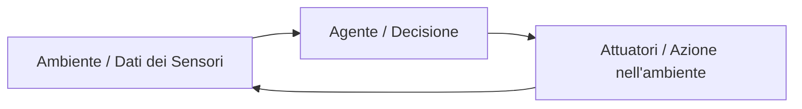

---
tags:
  - architetture-cognitive
  - agenti-intelligenti
  - modelli-generativi
  - ragionare
  - react
  - peas
---
## PEAS

Prima ancora di definire *come* l'[[Agente Razionale|agente]] agirà, è necessario definire *dove* e *perché*. Il modello **PEAS** formalizza la specifica del **Task Environment**, ossia il problema per il quale l'agente rappresenta la soluzione.

- **Performance Measure**
  Il criterio oggettivo di successo.
  Come regola generale, è opportuno progettare le misure di prestazione in base a ciò che si desidera effettivamente ottenere nell'ambiente, anzichè in base a come si ritiene che l'agente debba comportarsi.
- **[[Tassonomia degli Ambienti|Environment]]**
  Il contesto operativo.
- **Actuators**
  I dispositivi d'uscita con cui l'agente agisce.
- **Sensors**
  Gli strumenti d'input sensoriale.

## **Perception-Action-Cycle**

Una volta definito l'[[Tassonomia degli Ambienti|ambiente]] tramite il modello PEAS, si passa al funzionamento dinamico dell'agente.
In base ai dati ricevuti dai sensori, l'agente prende decizioni e le trasmette agli attuatori.
Queste decisioni avvengono in maniera iterativa nel tempo; l'insieme di ambiente, feedback dei sensori, decisione dell'agente ed interazione degli attuatori con l'ambiente è denominato **Perception-Action-Cycle**.

In questo flusso universale, i sensori  permettono la percezione, l'intelligenza dell'agente elabora l'informazione presa dal contesto, e aAttuatori eseguono l'azione.

## Il Modello ReAct

Se il modello PEAS è la progettazione strutturale e il Perception-Action-Cycle è la teoria logica, il modello **ReAct** *(Reasoning and Acting)* è l'implementazione pratica per i moderni **LLM**.

Gli LLM non hanno un corpo fisico o sensori hardware, quindi il ciclo viene simulato testualmente tramite un framework strutturato per l'utilizzo di tool esterni:

- **Observe**
  Il modello riceve l'input testuale dall'utente o i risultati restituiti da uno strumento.
- **Thought**
  Il modello esplicita il suo ragionamento su come procedere per raggiungere la sua _Performance Measure_.    
- **Act**
  Il modello genera un comando formale per invocare un tool esterno (un'API), che modificherà l'ambiente o genererà una nuova _Observe_, facendo ripartire il ciclo.

Questo stratagemma permette all'**intelligenza artificiale generativa** di agire come un agente autonomo, unendo il ragionamento profondo all'interazione con il mondo reale.
