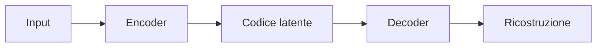

# Autoencoders

Capitolo: [[Modelli neurali profondi]]

Un **autoencoder** è una rete neurale addestrata a ricostruire il proprio input passando attraverso una rappresentazione interna, chiamata **codice latente**. Se riceve l'immagine di una cifra, deve produrre un'immagine il più possibile simile a quella iniziale. Lo scopo non è semplicemente ottenere una copia: è **imparare una rappresentazione che conservi le caratteristiche utili dei dati**.

Il problema nasce dal fatto che un dato può avere molte componenti numeriche, ma una struttura più semplice. Un'immagine contiene un valore per ogni pixel; tuttavia forma, orientamento e spessore dei tratti possono spiegare buona parte delle differenze fra immagini di cifre. Un autoencoder cerca di apprendere regolarità di questo tipo senza ricevere esplicitamente i nomi delle caratteristiche da conservare.

## Encoder, spazio latente e decoder

La rete comprende un **encoder**, che *trasforma l'input $x$ nel codice $z$*, e un **decoder**, che *usa quel codice per produrre la ricostruzione* $\hat{x}$:

$$
z=f_\phi(x),\qquad \hat{x}=g_\theta(z).
$$

I simboli $\phi$ e $\theta$ indicano i parametri appresi dalle due parti. Il codice è detto latente perché non viene fornito direttamente nei dati: è una rappresentazione interna costruita durante l'apprendimento. Encoder e decoder possono essere reti con più strati e trasformazioni non lineari; per immagini possono usare anche strati convoluzionali, capaci di trattare la struttura spaziale.

Consideriamo un esempio con immagini in scala di grigi di 28 per 28 pixel: ogni immagine è descritta da 784 numeri. Possiamo progettare un encoder che li trasformi in 32 valori e un decoder che da quei 32 valori ricostruisca i 784 pixel. Il passaggio centrale è un **collo di bottiglia**: *limita la quantità di informazione rappresentabile direttamente e spinge la rete a sfruttare le regolarità condivise fra gli esempi.*

Non significa che ciascuno dei 32 valori corrisponda automaticamente a un concetto interpretabile, come «inclinazione» o «spessore». Le informazioni possono essere distribuite fra più componenti del codice.

## Come avviene l'addestramento

Per ogni esempio si calcola la ricostruzione e la si confronta con l'input originale. Una possibile **loss function**, che misura l'errore da ridurre, è l'errore quadratico medio:

$$
L_{rec}(x,\hat{x})=\frac{1}{d}\sum_{j=1}^{d}(x_j-\hat{x}_j)^2,
$$

dove $d$ è il numero di componenti dell'input. Per le immagini dell'esempio, $d=784$. Se la rete ricostruisce male un tratto della cifra, le differenze nei pixel interessati aumentano la perdita. La backpropagation calcola come i parametri dell'encoder e del decoder contribuiscano all'errore; un algoritmo di ottimizzazione li aggiorna per ridurlo su gruppi di esempi.

Il bersaglio dell'addestramento è quindi il dato stesso. Non occorre conoscere l'etichetta «questa è una cifra 7»: la rete deve ricostruire l'immagine, non classificarla. Per questo l'apprendimento viene tradizionalmente collocato fra i metodi non supervisionati e può anche essere descritto come [[Self-supervised learning|self-supervised learning]], perché il segnale di supervisione è ricavato dai dati.

La loss function dipende dal tipo di dato e dalla scelta del modello. L'errore quadratico è un esempio, non una proprietà obbligatoria di ogni autoencoder.

## Perché servono vincoli sulla rappresentazione

Se la rete avesse capacità sufficiente e nessun vincolo, potrebbe imparare a copiare l'input senza costruire una rappresentazione riutilizzabile. Un codice di dimensione inferiore all'input definisce un autoencoder **undercomplete**, ma nemmeno un collo di bottiglia garantisce da solo che la rete apprenda *caratteristiche utili*: con capacità eccessiva può comunque memorizzare gli esempi di addestramento.

Si possono allora aggiungere forme di **regolarizzazione**, cioè vincoli che scoraggiano soluzioni poco utili. Uno ***sparse autoencoder*** penalizza un'attivazione eccessivamente diffusa del codice, favorendo rappresentazioni in cui poche componenti siano attive per ciascun esempio. Un ***denoising autoencoder*** riceve invece un input alterato dal rumore, ma deve ricostruire quello pulito. Per riuscirci deve sfruttare la struttura regolare del dato, perché copiare anche il rumore non risolve il compito.

Nel caso di un'immagine di cifra con alcuni pixel disturbati, l'input della rete è l'immagine corrotta e il bersaglio è l'originale. La rimozione del rumore viene appresa da queste coppie, non è una conseguenza automatica di qualunque rete encoder-decoder.

## Impieghi e limiti

Dopo l'addestramento si può usare soltanto l'encoder per ottenere rappresentazioni più compatte, oppure l'intera rete per ricostruire e ripulire i dati. Un altro impiego è il rilevamento di anomalie: addestrando la rete su esempi normali, si può usare un errore di ricostruzione elevato come indizio di un dato insolito. Il criterio va però verificato: una rete può ricostruire bene anche un'anomalia, oppure male un esempio normale diverso da quelli osservati.

Un autoencoder ordinario non stabilisce necessariamente come campionare nuovi codici latenti. Il decoder può ricostruire bene i codici prodotti dall'encoder, ma ricevere un punto casuale in una regione mai utilizzata durante l'addestramento può produrre un risultato privo di significato. I [[Variational Autoencoders]] affrontano questo problema introducendo un modello probabilistico e un vincolo sulla distribuzione dei codici.
