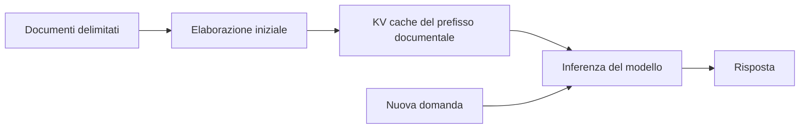

# CAG

*Cache-Augmented Generation*. Il sistema precarica un insieme delimitato di documenti nel contesto del modello linguistico e conserva lo stato di elaborazione riutilizzabile. Le domande successive vengono elaborate utilizzando quello stato, senza una ricerca documentale specifica per ogni richiesta.

## Che cosa viene conservato nella cache

Nella generazione autoregressiva, ogni nuovo token dipende dal contesto precedente. Per evitare di ricalcolare continuamente alcune operazioni già svolte, il [[Architettura Transformer e meccanismo di attenzione|Transformer]] può conservare le rappresentazioni key e value dei token elaborati. Questa struttura prende il nome di **KV cache** e viene mantenuta nei livelli di attenzione del modello.

Quando vengono elaborati nuovi token, le loro rappresentazioni vengono aggiunte alla cache; l'attenzione utilizza anche quelle precedenti. La cache conserva quindi risultati intermedi del calcolo, non un insieme di risposte già pronte. Non è neppure una modifica dei pesi del modello: appartiene allo stato dell'inferenza e dipende dal contesto elaborato.

Nel CAG, il riuso riguarda il prefisso documentale comune a più domande. La possibilità di riutilizzare uno stato già calcolato spiega il vantaggio rispetto a ripresentare e rielaborare ogni volta gli stessi documenti.

## Preparazione e risposta alle domande

La preparazione raccoglie e formatta i documenti pertinenti all'applicazione, verificando che rientrino nel contesto disponibile, lasciando spazio anche alla domanda ed alla risposta. Il modello li elabora e produce una cache riutilizzabile. Alla domanda successiva viene associato questo stato precalcolato: il modello continua l'elaborazione e genera la risposta tenendo conto dei documenti già disponibili.

Per trattare domande indipendenti, la cache può essere riportata allo stato documentale iniziale, eliminando dalla cache le rappresentazioni associate ai token aggiunti durante la singola interazione. Si conserva così il prefisso comune senza trascinare necessariamente le domande e le risposte precedenti. La gestione della cronologia conversazionale resta una scelta distinta.

## Il confronto con il RAG

Nel [[RAG]], la domanda determina quali passaggi recuperare da un archivio; il generatore riceve quei passaggi come contesto. Nel CAG, la conoscenza documentale prevista per l'applicazione è già precaricata. Si elimina la selezione dinamica dei documenti, mentre rimane il compito di utilizzare correttamente le informazioni disponibili.

Come esempio esplicativo, un assistente può ricevere in anticipo un piccolo insieme di manuali su cui verranno poste molte domande. Nel CAG, lo stato di quel contesto viene riutilizzato; nel RAG, ogni domanda avvia una ricerca dei passaggi pertinenti. Il confronto riguarda dove e quando si seleziona ed elabora la conoscenza, non la verità automatica delle risposte.

Una KV cache può essere utilizzata anche durante la generazione di un sistema RAG. Il caching è un meccanismo di efficienza; la scelta fra precaricamento e recupero riguarda invece l'organizzazione dell'accesso ai documenti.

## Condizioni e limiti

Poiché la cache dipende dal contesto elaborato, deve rimanere coerente con i documenti utilizzati. Se questi cambiano, lo stato precedente non rappresenta automaticamente la nuova versione: occorre elaborare il contesto aggiornato e mantenere una cache coerente. Inoltre, conservare le key e value richiede memoria, la cui occupazione cresce con i token mantenuti.

Il precaricamento richiede che la conoscenza rilevante sia di dimensione gestibile e rientri nella finestra di contesto. Una raccolta molto grande può rendere questo approccio impraticabile; inoltre, la capacità nominale del contesto non assicura che il modello sfrutti bene tutte le informazioni. Il vantaggio di evitare errori del retriever non elimina gli errori di interpretazione o generazione.

La valutazione deve considerare insieme qualità, costo e quantità di contesto. I confronti fra RAG e modelli a contesto lungo mostrano che le prestazioni e i costi possono favorire soluzioni diverse secondo il compito e le risorse. Un approccio ibrido può scegliere quando usare il recupero e quando fornire un contesto più ampio; questa possibilità non equivale a una dimostrazione che il CAG sostituisca sempre il RAG.

Le valutazioni iniziali del CAG utilizzano Llama 3.1 8B, raccolte delimitate derivate da SQuAD e HotPotQA e BERTScore per confrontare le risposte. I risultati riguardano quelle configurazioni: non costituiscono una garanzia su archivi arbitrari o modelli differenti.
