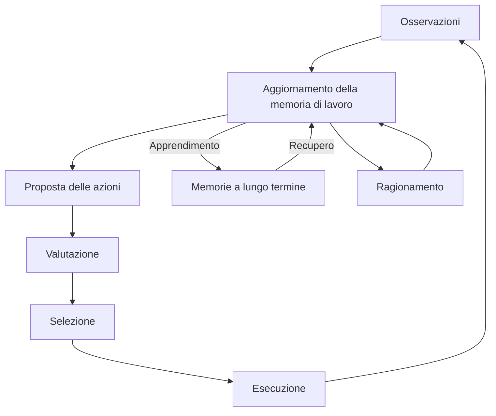

# CoALA

CoALA, acronimo di *Cognitive Architectures for Language Agents*, è un quadro concettuale per descrivere e progettare agenti basati su modelli di linguaggio. Organizza il funzionamento dell'agente attraverso componenti di memoria, azioni interne, interazioni con l'ambiente e un processo decisionale che coordina queste attività. Il modello linguistico svolge un ruolo all'interno di questa organizzazione; il comportamento complessivo dipende anche dalle informazioni conservate, dalle procedure disponibili e dal modo in cui vengono scelte le azioni.

## Dal modello linguistico all'agente cognitivo

Un modello linguistico riceve un input e produce un output. Quando viene inserito in un agente, il suo output può contribuire a scegliere azioni, mentre le osservazioni ottenute dall'ambiente diventano nuovi input. Il comportamento assume così una forma ciclica: l'agente osserva, elabora informazioni, agisce e utilizza gli effetti dell'azione per proseguire.

CoALA rende esplicita l'organizzazione interna di questo ciclo. Un agente può recuperare un'esperienza pertinente, ragionare sulle informazioni disponibili, conservare un nuovo risultato oppure intervenire su un sistema esterno. Distinguere queste operazioni permette di capire quali informazioni sostengano una decisione e quali parti dell'agente vengano modificate durante il suo funzionamento.

## Memoria di lavoro e memorie a lungo termine

La memoria di lavoro contiene le informazioni attive e immediatamente disponibili per il ciclo decisionale corrente. Comprende osservazioni, risultati del ragionamento, conoscenze recuperate dalle memorie a lungo termine e informazioni mantenute dal ciclo precedente. È lo spazio nel quale vengono riuniti gli elementi utili per decidere che cosa fare. Negli agenti linguistici, il contesto fornito al modello può rendere accessibile una parte di queste informazioni.

La memoria episodica conserva esperienze specifiche: eventi precedenti, interazioni, traiettorie di gioco o altri resoconti dell'attività dell'agente. Il suo contenuto rimane legato a ciò che è accaduto in una certa situazione. Recuperare un episodio può fornire un precedente utile al [[Ragionamento basato su casi]], senza garantire che la stessa scelta sia appropriata nel nuovo contesto.

La memoria semantica conserva conoscenze sul mondo e sull'agente. La differenza rispetto a quella episodica riguarda la funzione del contenuto: una conoscenza semantica viene utilizzata come informazione generale, mentre un episodio viene ricordato come esperienza specifica. L'agente può scrivere nella memoria semantica nuove informazioni ottenute attraverso l'elaborazione delle proprie esperienze.

La memoria procedurale riguarda il funzionamento dell'agente e comprende due forme di conoscenza: quella implicita nei parametri del modello linguistico e quella esplicita nel codice. Il codice può implementare procedure di recupero, ragionamento, apprendimento e interazione con l'ambiente, oltre alla stessa procedura decisionale. La conoscenza procedurale non coincide quindi con un elenco testuale di istruzioni: comprende anche i meccanismi che rendono eseguibili le operazioni dell'agente.

## Recuperare, ragionare e apprendere

Il recupero, o *retrieval*, trasferisce informazioni dalle memorie a lungo termine alla memoria di lavoro. Non produce necessariamente una nuova conclusione: rende disponibile qualcosa che era già conservato. La pertinenza del recupero dipende dai criteri adottati. Per esempio, un'esperienza può essere selezionata combinando recenza, importanza e rilevanza rispetto alla situazione corrente.

Il ragionamento legge ed elabora il contenuto della memoria di lavoro per produrre nuove informazioni. Può riassumere un'osservazione, ricostruire una sequenza di eventi o combinare conoscenze recuperate. I risultati possono sostenere la scelta dell'azione successiva oppure essere conservati nelle memorie a lungo termine.

L'apprendimento consiste nello scrivere o aggiornare informazioni a lungo termine. Può riguardare la registrazione di nuovi episodi, l'aggiunta di conoscenze semantiche, la modifica dei parametri del modello oppure l'aggiornamento del codice e delle procedure dell'agente. Sono modifiche differenti: salvare il resoconto di un'interazione rende disponibile una nuova esperienza, ma non comporta di per sé un aggiornamento dei parametri del modello linguistico.

Questa distinzione aiuta a comprendere anche il [[Comprensione del linguaggio e integrazione della conoscenza|rapporto fra modello e conoscenza esterna]]. Un'informazione può influenzare una risposta perché è stata recuperata nel contesto corrente, anche quando i parametri del modello rimangono invariati.

## Interagire con l'ambiente

Le azioni di *grounding* collegano l'agente a ciò che è esterno alla sua elaborazione interna. Comprendono il dialogo con persone o altri agenti, l'interazione con ambienti digitali e l'azione in ambienti fisici. Un agente può usare un'API, interagire con un sito, eseguire codice oppure inviare comandi a un sistema robotico e riceverne osservazioni.

La distinzione dipende dal ruolo dell'operazione. Recuperare un ricordo serve a renderlo disponibile per l'elaborazione interna; inviare un comando a un dispositivo produce invece un'interazione con un sistema esterno. Nell'[[Sfide dell’interazione multimodale|interazione multimodale]] di un agente fisico, osservazioni visive, sonore o tattili devono essere trasformate in rappresentazioni utilizzabili dal modello linguistico.

## Il processo decisionale

La procedura decisionale organizza proposta, valutazione, selezione ed esecuzione delle azioni. A partire dalle osservazioni e dal contenuto della memoria di lavoro, l'agente costruisce possibili azioni e ne valuta l'adeguatezza. Il ragionamento e il recupero di informazioni possono sostenere questa fase di pianificazione. L'agente seleziona quindi un'azione, la esegue e prosegue il ciclo sulla base delle informazioni aggiornate.

Lo schema seguente sintetizza il ciclo. La memoria di lavoro mantiene il contesto utilizzato durante l'elaborazione; le nuove osservazioni permettono di riprendere la proposta e la valutazione delle alternative.

Il ciclo descrive un'organizzazione funzionale. Non impone che ogni agente utilizzi tutte le memorie o esegua tutte le operazioni a ogni decisione. Per comprendere un sistema concreto occorre precisare quali componenti siano presenti e come comunichino fra loro.

## Un esempio di funzionamento

Come esempio esplicativo, consideriamo un agente che deve risolvere un problema in un ambiente digitale. La richiesta e le osservazioni correnti entrano nella memoria di lavoro. L'agente recupera un episodio relativo a un problema simile e ragiona sulle differenze rispetto alla situazione attuale. Propone quindi alcune azioni e ne seleziona una, per esempio una chiamata a un'API.

L'esecuzione produce una nuova osservazione che aggiorna la memoria di lavoro. Se l'agente conserva l'interazione nella memoria episodica, quell'esperienza potrà essere recuperata in futuro. Il recupero ha reso disponibile un precedente; il ragionamento lo ha confrontato con il problema corrente; l'azione ha coinvolto l'ambiente; l'apprendimento ha conservato nuova informazione. L'esempio distingue le operazioni senza assumere che il semplice recupero garantisca una soluzione corretta.

## Il rapporto con SOAR

[[SOAR Cognitive Architecture]] e CoALA condividono l'interesse per l'integrazione di memoria, ragionamento, apprendimento e scelta dell'azione. In SOAR, le regole di produzione e le preferenze sugli operatori hanno un ruolo centrale nel controllo del comportamento. CoALA utilizza un'organizzazione cognitiva per descrivere agenti nei quali intervengono modelli linguistici, codice e memorie esterne.

Le due architetture condividono questi principi organizzativi, ma adottano meccanismi differenti. Recuperare un episodio in un agente linguistico non equivale automaticamente al chunking di SOAR; una riflessione generata dal modello non implica la creazione di un sotto-obiettivo secondo le regole di SOAR. Per confrontare due agenti occorre verificare quali rappresentazioni impieghino, come scelgano le azioni e che cosa modifichino quando apprendono.
