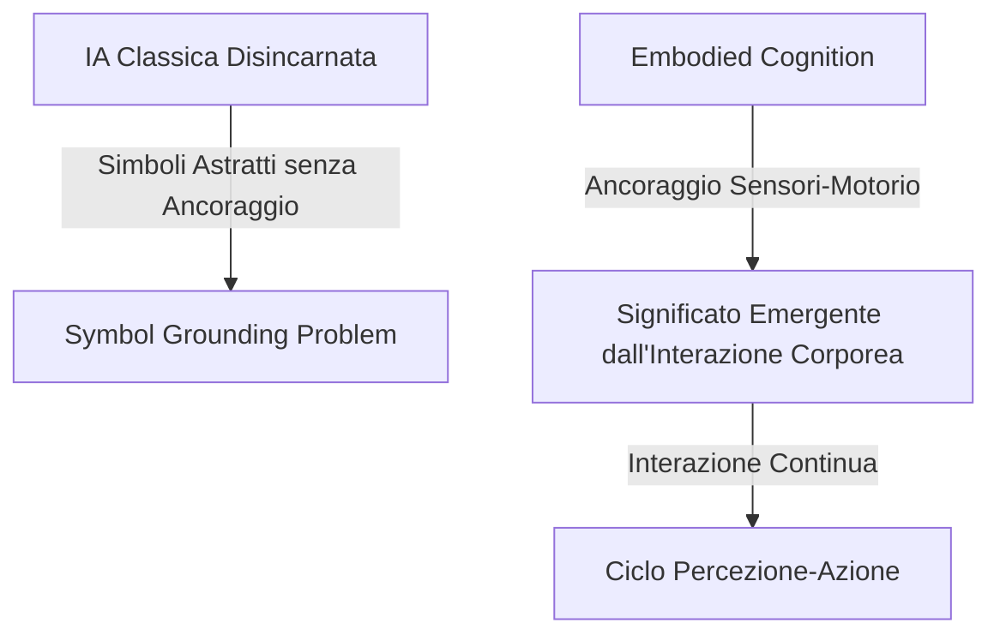

---
tags:
  - cognizioni-incarnate
  - sistemi-robotici
  - scienze-cognitive
  - interagire
---
La teoria della **Embodied Cognition** rappresenta un cambio di paradigma fondamentale nello studio dell'Intelligenza Artificiale e delle Scienze Cognitive. A differenza dei modelli tradizionali che concepiscono la mente come un programma software astratto ed indipendente dal supporto fisico, l'approccio dell'embodiment sostiene che i processi cognitivi siano inestricabilmente radicati nella morfologia del corpo fisico, nelle sue strutture sensori-motorie e nelle sue interazioni dirette con l'ambiente naturale.

## Origine del Concetto e Critica al Paradigma Simbolico

Per molti decenni l'Intelligenza Artificiale classica ha operato secondo l'assunto del funzionalismo computazionale, considerando il corpo come un semplice periferico d'ingresso e d'uscita. In questo modello disincarnato, la percezione si limita a raccogliere stimoli trasformandoli in simboli astratti, mentre la cognizione consiste unicamente nella manipolazione algebrica di tali simboli.

La Embodied Cognition nasce per superare il celebre **Symbol Grounding Problem** formulato da Stevan Harnad. Se un sistema manipola simboli basandosi unicamente sulle loro relazioni con altri simboli, i concetti rimangono privi di un reale significato ancorato al mondo fisico. La cognizione incarnata dimostra che il significato di un concetto nasce direttamente dall'esperienza sensori-motoria del corpo che interagisce con gli oggetti.

## Il Rifiuto del Dualismo e del Funzionalismo

Nelle ricerche di Tom Ziemke del 2016, l'approccio della cognizione incarnata formalizza un netto rifiuto delle posizioni filosofiche tradizionali.

- **Dualismo Mente-Corpo**
  L'idea che la mente sia un entità separata ed indipendente dal corpo fisico.
- **Funzionalismo**
  L'assunto che tratta i meccanismi cognitivi in modo totalmente indipendente dalla piattaforma fisica su cui vengono eseguiti:
	* **Computational Functionalism**: l'idea che la cognizione sia solo un algoritmo astratto eseguibile su qualsiasi hardware.
	* **Robotic Functionalism**: l'idea che il corpo sia una mera periferica intercambiabile priva di ruolo nella struttura dei concetti.

## Morfologia Corporea e Contingenze Sensori-Motorie

La struttura fisica dell'agente gioca un ruolo attivo nei processi di elaborazione dell'informazione, sgravando il cervello o l'unità centrale da calcoli complessi attraverso la cosiddetta **Morphological Computation**.

- **Contingenze Sensori-Motorie**
  Rappresentano le relazioni sistematiche che l'agente apprende tra i propri movimenti motori ed i conseguenti mutamenti nella percezione. L'agente comprende lo spazio e la geometria degli oggetti imparando come una determinata azione modifichi il flusso sensoriale.

- **Active Perception ed Affordance**
  In linea con la psicologia ecologica di James Gibson, la percezione non è un processo passivo. L'agente percepisce l'ambiente in termini di affordance, ossia le opportunità d'azione concrete che gli oggetti offrono in base alla forma del corpo dell'agente. Un oggetto non viene categorizzato con un'etichetta astratta, ma percepito direttamente come afferrabile, calpestabile o superabile.

## Embodied Cognition nella Robotica e negli Agenti Artificiali
  
L'applicazione pratica della Embodied Cognition nell'Intelligenza Artificiale ha trovato la sua massima espressione nel lavoro di Rodney Brooks e nella nascita della Behavior-Based Robotics.

Brooks ha dimostrato che per realizzare comportamenti intelligenti in ambienti complessi non occorre costruire rappresentazioni interne dettagliate del mondo. Attraverso l'**architettura di sussunzione**, l'agente sfrutta il mondo reale come proprio modello migliore, collegando direttamente i sensori agli attuatori mediante strati di comportamento accoppiati dinamicamente con l'ambiente.

Nelle architetture cognitive dello sviluppo descritte nei desiderata di **[[Developmental cognitive architectures|David Vernon]]** e colleghi nel 2016, il Physical Embodiment è indicato come il secondo desideratum fondamentale. Un agente privo di incarnazione fisica non può sviluppare una reale autonomia costitutiva né effettuare una simulazione interna efficace del mondo.

## Confronto tra Agenti Disincarnati ed Agenti Incarnati

La tabella riassume le differenze concettuali tra la visione disincarnata dell'IA tradizionale e la visione incarnata della Embodied Cognition.

| Caratteristica | Agente Disincarnato (Disembodied) | Agente Incarnato (Embodied) |
| :--- | :--- | :--- |
| Sede della Cognizione | Unità centrale di calcolo astratta | Sistema integrato Corpo-Cervello-Ambiente |
| Natura dei Concetti | Simboli logici e manipolazioni algebriche | Pattern sensori-motori ed esperienze fisiche |
| Ruolo dei Sensori | Trasduttori passivi di dati grezzi | Strumenti attivi di esplorazione guidati dall'azione |
| Ruolo del Corpo | Supporto secondario ed intercambiabile | Struttura primaria che plasma ed organizza la mente |
| Relazione con il Mondo | Rappresentata internamente tramite mappe statiche | Usato direttamente come modello dinamico attraverso l'azione |
