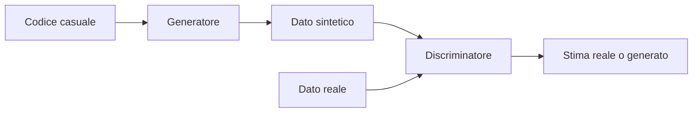

 # Generative Adversarial Networks

Capitolo: [[Modelli neurali profondi]]

Una **Generative Adversarial Network**, abbreviata **GAN**, è un modello generativo addestrato attraverso la competizione fra due reti: un **generatore**, che produce dati sintetici, e un **discriminatore**, che cerca di distinguere i dati reali da quelli generati. Il generatore migliora usando il segnale fornito dal discriminatore; il discriminatore migliora confrontandosi con esempi sintetici che cambiano durante l'addestramento.

Consideriamo un insieme di immagini di cifre manoscritte. Vogliamo produrre nuove immagini compatibili con quel tipo di dato, senza fornire per ciascuna uscita un'immagine precisa da copiare. Il problema è apprendere la distribuzione degli esempi: quali forme siano plausibili e con quale varietà si presentino.

## Generatore e discriminatore

Il **generatore** $G$ riceve un vettore casuale $z$, campionato da una distribuzione semplice, per esempio una normale standard, e lo trasforma in un esempio sintetico $\tilde{x}=G(z)$. Il vettore casuale introduce la variabilità: codici differenti dovrebbero permettere di produrre immagini differenti. La rete impara a trasformare questo rumore in strutture simili a quelle dei dati.

Il **discriminatore** $D$ riceve invece un'immagine e produce un valore fra 0 e 1. Nella GAN classica questo valore è addestrato come stima della probabilità che l'immagine provenga dai dati reali, anziché dal generatore. Il discriminatore vede esempi di entrambe le origini e conosce le rispettive etichette: reale oppure generato.

Nella GAN di base non esiste una corrispondenza obbligatoria fra un codice casuale e una specifica immagine reale. Il generatore non deve ricostruire un'immagine ricevuta in input: deve produrre esempi che il discriminatore trovi credibili. Questa è una differenza centrale rispetto agli [[Autoencoders]] e ai [[Variational Autoencoders]].

## Come si addestrano le due reti

L'addestramento alterna aggiornamenti del discriminatore e del generatore. Quando si aggiorna il **discriminatore**, si confrontano le sue risposte su immagini reali e sintetiche. Se assegna un valore alto a un'immagine generata o basso a una reale, commette un errore; la perdita di classificazione serve a correggere i suoi parametri. In questo passaggio i parametri del generatore rimangono fermi.

Quando si aggiorna il **generatore**, si producono nuove immagini e le si fanno valutare dal discriminatore. I parametri del discriminatore restano fermi, ma il gradiente attraversa le sue operazioni e raggiunge il generatore. Il segnale indica come cambiare la produzione per ottenere valutazioni più alte. Il discriminatore non viene quindi usato soltanto come giudizio finale vero/falso: deve fornire un segnale numerico utile ad apprendere.

Per esempio, supponiamo che assegni 0,9 a una cifra reale e 0,2 a una generata. Sono risposte coerenti con le origini dei due esempi, perciò utili al discriminatore. Il generatore cerca invece di modificare le proprie immagini in modo che il secondo punteggio aumenti. Non basta impostare direttamente quel punteggio: deve cambiare l'immagine passando attraverso i parametri della rete.

La ripetizione di questi aggiornamenti crea un problema in cui *anche il criterio di valutazione evolve*. *Mentre il generatore migliora, il discriminatore deve imparare differenze più sottili*; mentre il discriminatore migliora, il generatore riceve nuove indicazioni sui difetti delle proprie uscite.

## Il significato dell'obiettivo avversario

L'obiettivo originale può essere scritto come un gioco **minimax**, in cui il discriminatore massimizza un criterio che il generatore cerca di minimizzare:

$$
\min_G\max_D\left[
\mathbb{E}_{x\sim p_{data}}\log D(x)
+\mathbb{E}_{z\sim p(z)}\log\bigl(1-D(G(z))\bigr)
\right].
$$

$\mathbb{E}$ indica una media: il primo termine riguarda immagini reali estratte dai dati, il secondo immagini prodotte da codici casuali. Il discriminatore aumenta il criterio riconoscendo i dati reali e rifiutando quelli sintetici. Il generatore agisce sul secondo termine, cercando di aumentare $D(G(z))$.

Nella pratica, per il generatore si usa spesso una perdita alternativa:

$$
L_G=-\mathbb{E}_{z\sim p(z)}\log D(G(z)).
$$

Minimizzarla significa ancora spingere il discriminatore a considerare reali le immagini sintetiche, ma fornisce un segnale più utile all'inizio, quando queste vengono respinte con grande sicurezza. È detta perdita **non saturante**. La formula minimax spiega il gioco originario; non implica che ogni implementazione utilizzi esattamente quella stessa perdita per il generatore.

## Quando la competizione ha successo

Nell'analisi ideale, con capacità sufficiente e ottimizzazione adeguata, il generatore può riprodurre la distribuzione dei dati. Se le due distribuzioni coincidono e le origini sono presentate con uguale probabilità, il discriminatore ottimale restituisce 0,5: non ha informazioni per distinguerle.

Osservare un punteggio vicino a 0,5 durante un esperimento non dimostra però di aver raggiunto questo equilibrio. Anche un discriminatore poco addestrato potrebbe rispondere così. Bisogna valutare sia la qualità sia la varietà dei campioni, senza affidarsi a una sola perdita o all'accuratezza del discriminatore.

Un difetto caratteristico è il **mode collapse**: codici diversi producono esempi uguali o molto simili. Per un generatore di cifre, potrebbe significare ottenere quasi soltanto immagini convincenti del numero 3, ignorando le altre cifre. I singoli esempi possono apparire buoni, ma la distribuzione generata non rappresenta la varietà dei dati.

## Impieghi e limiti

Le GAN sono usate per sintetizzare immagini e, in varianti condizionate, per controllare la generazione attraverso informazioni aggiuntive. Se a generatore e discriminatore si fornisce anche l'etichetta della cifra, il generatore può imparare a produrre la classe richiesta. Architetture e obiettivi ulteriori permettono applicazioni come la trasformazione di immagini, ma non sono tutti impliciti nella GAN di base.

La competizione può rendere l'addestramento instabile: le reti possono oscillare, sbilanciarsi o fornire gradienti poco utili. Inoltre la GAN di base offre un modo per campionare dati, ma non una semplice procedura per calcolare la probabilità di un'immagine o per risalire al suo codice latente. Dopo l'addestramento, per generare basta il generatore; il discriminatore ha svolto soprattutto il ruolo di segnale di apprendimento.
