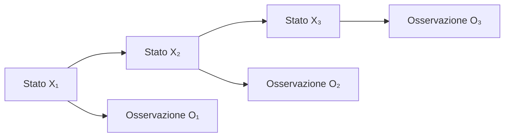

---
tags:
  - probabilita
  - incertezza
  - modelli-sequenziali
aliases:
  - Catene di Markov Nascoste
  - Modelli di Markov nascosti
  - HMM
---

# Hidden Markov Models

Collegamenti: [[The problem of knowledge representation]] · [[Tassonomia degli Ambienti]] · [[Ragionamento in condizioni di incertezza]]

Un **Hidden Markov Model (HMM)**, o **modello di Markov nascosto**, descrive un processo che evolve nel tempo attraverso stati non osservati direttamente. Di questi stati si osservano soltanto degli effetti, detti **osservazioni** o **emissioni**. Il problema consiste nell'usare tali indizi per stimare ciò che sta accadendo.

Nelle fonti del corso gli HMM sono richiamati per la memoria negli ambienti parzialmente osservabili e per la rappresentazione atomica degli stati. La spiegazione tecnica seguente integra questi richiami con le lezioni universitarie indicate in [[Fonti#Hidden Markov Models|Fonti]].

## Dalla catena di Markov agli stati nascosti

Indichiamo con $X_t$ lo stato al tempo $t$. In una **catena di Markov del primo ordine**, lo stato corrente contiene l'informazione necessaria per prevedere il successivo:

$$
P(X_{t+1}\mid X_1,\ldots,X_t)=P(X_{t+1}\mid X_t).
$$

La proprietà riguarda una **dipendenza condizionata**: una volta noto $X_t$, gli stati precedenti non aggiungono informazione sulla transizione successiva. È un'ipotesi del modello, che va valutata rispetto al processo rappresentato. Il modello di transizione assegna le probabilità dei passaggi fra stati; nella versione omogenea tali probabilità restano uguali nel tempo. [Riferimento: UC Berkeley, Markov Models](https://inst.eecs.berkeley.edu/~cs188/textbook/hmms/markov.html).

In un HMM lo stato $X_t$ è nascosto, mentre è osservabile una variabile $O_t$. Nel modello standard, ciascuna emissione dipende soltanto dallo stato che la produce. Questa indipendenza vale **condizionatamente allo stato**: le osservazioni possono comunque essere correlate nel tempo attraverso la catena degli stati.

## Componenti del modello

Per un HMM con stati e osservazioni discreti si specificano:

| Componente | Notazione | Significato |
| :--- | :--- | :--- |
| Stati possibili | $S=\{s_1,\ldots,s_N\}$ | Situazioni nascoste ammesse dal modello. |
| Distribuzione iniziale | $\pi_i=P(X_1=s_i)$ | Probabilità di iniziare in ciascuno stato. |
| Transizioni | $a_{ij}=P(X_{t+1}=s_j\mid X_t=s_i)$ | Probabilità di passare dallo stato $i$ allo stato $j$. |
| Emissioni | $b_j(o)=P(O_t=o\mid X_t=s_j)$ | Probabilità di osservare $o$ nello stato $j$. |

Le probabilità iniziali sommano a 1; anche ogni riga delle transizioni e ogni distribuzione delle emissioni sommano a 1. **Emissione e inferenza hanno versi diversi**: $P(O_t\mid X_t)$ descrive il sensore; per ricavare $P(X_t\mid O_t)$ servono anche le probabilità degli stati e la normalizzazione. [Riferimento: UC Berkeley, Hidden Markov Models](https://inst.eecs.berkeley.edu/~cs188/textbook/hmms/hmm.html).

## Esempio: una macchina e un allarme rumoroso

Consideriamo un esempio didattico costruito per questa nota. Una macchina può essere **regolare** ($R$) oppure **guasta** ($G$); osserviamo soltanto se un allarme si accende. All'inizio poniamo $P(X_1=R)=0{,}8$ e $P(X_1=G)=0{,}2$.

| Stato corrente | Prossimo stato $R$ | Prossimo stato $G$ | Allarme acceso nello stato corrente |
| :--- | :--- | :--- | :--- |
| $R$ | $0{,}9$ | $0{,}1$ | $0{,}1$ |
| $G$ | $0{,}2$ | $0{,}8$ | $0{,}9$ |

Le prime due colonne numeriche descrivono le transizioni; l'ultima descrive il sensore. L'allarme può quindi produrre falsi positivi e mancare un guasto.

Se al primo istante osserviamo l'allarme acceso, pesiamo ciascuno stato per la probabilità di produrre quell'osservazione:

$$
\begin{aligned}
w_R&=0{,}8\cdot0{,}1=0{,}08,\\
w_G&=0{,}2\cdot0{,}9=0{,}18.
\end{aligned}
$$

Dividendo per la somma $0{,}26$ otteniamo:

$$
P(X_1=G\mid O_1=\text{acceso})
=\frac{0{,}18}{0{,}26}\approx0{,}6923.
$$

Il guasto diventa più probabile, ma non certo. **Il valore $0{,}9$ della tabella non è la probabilità di guasto dopo l'allarme**: è la probabilità di allarme quando il guasto è già dato.

Prima di leggere il sensore al secondo istante, usiamo le transizioni:

$$
P(X_2=G\mid O_1=\text{acceso})
=\frac4{13}\cdot0{,}1+\frac9{13}\cdot0{,}8
\approx0{,}5846.
$$

Una nuova osservazione aggiornerà questa previsione. L'informazione precedente continua così a contribuire alla stima.

## Filtraggio e algoritmo forward

Il **filtraggio** stima lo stato corrente usando tutte le osservazioni disponibili: $P(X_t\mid o_{1:t})$, dove $o_{1:t}$ indica la sequenza osservata fino a $t$. Si alternano previsione mediante le transizioni e aggiornamento mediante il sensore, come nell'esempio. La distribuzione sugli stati costituisce una memoria probabilistica utile a un [[Model-Based Reflex Agents|agente basato su modello]].

L'algoritmo **forward** può lavorare con le probabilità congiunte $\alpha_t(j)=P(o_{1:t},X_t=s_j)$:

$$
\alpha_1(j)=\pi_j b_j(o_1),\qquad
\alpha_t(j)=b_j(o_t)\sum_i\alpha_{t-1}(i)a_{ij}.
$$

La somma su tutti gli stati finali dà $P(o_{1:T})$; normalizzando $\alpha_t$ si ottiene invece la distribuzione filtrata, purché la sequenza osservata abbia probabilità positiva nel modello. [Riferimenti: Berkeley, algoritmo forward](https://inst.eecs.berkeley.edu/~cs188/textbook/hmms/hmm.html); [Jurafsky e Martin, appendice A, § A.3](https://web.stanford.edu/~jurafsky/slp3/A.pdf#page=4).

## Sequenza più probabile e apprendimento

**Viterbi** cerca l'intera sequenza di stati più probabile date le osservazioni:

$$
x^*_{1:T}=\arg\max_{x_{1:T}}P(x_{1:T}\mid o_{1:T}).
$$

Usa la programmazione dinamica: conserva, per ciascuno stato e istante, il miglior percorso che vi arriva e il predecessore necessario a ricostruirlo. Mentre il forward **somma** i contributi dei percorsi, Viterbi seleziona il **massimo**. Scegliere separatamente lo stato più probabile a ogni istante non garantisce la sequenza complessivamente più probabile. [Riferimento: UC Berkeley, Viterbi](https://inst.eecs.berkeley.edu/~cs188/textbook/hmms/viterbi.html).

Quando gli stati sono etichettati nei dati, i parametri si possono stimare dai conteggi. Quando sono nascosti, **Baum-Welch**, una forma di Expectation-Maximization, alterna la stima dei conteggi attesi tramite forward-backward e l'aggiornamento dei parametri. [Riferimento: Jurafsky e Martin, § A.5](https://web.stanford.edu/~jurafsky/slp3/A.pdf#page=10).

## Collegamenti e limiti

Nel formalismo atomico richiamato in [[The problem of knowledge representation]], ciascuno stato è identificato come un'alternativa distinta. Gli HMM forniscono un esempio di come ragionare su tali alternative quando non sono direttamente osservabili. I [[Markov Decision Processes]] aggiungono invece al modello decisionale azioni e ricompense, già introdotte nella nota dedicata.

Le ipotesi di primo ordine, indipendenza delle emissioni e omogeneità rendono il calcolo trattabile, ma possono descrivere male un processo reale. Per esempio, se due guasti diversi producono sempre gli stessi segnali e hanno identica dinamica, il solo allarme non permette di distinguerli. L'affidabilità della stima dipende quindi anche dagli stati scelti e dall'informazione resa disponibile dal sensore.
