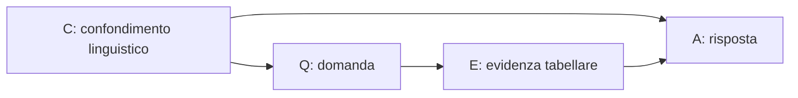

---
tags:
  - ragionamento
  - causalita
  - inferenza
  - bias
---

Capitolo: [[Ragionamento, inferenza causale e spiegazione]]

L'inferenza causale studia le relazioni di influenza fra fenomeni e le conseguenze di un intervento. La sua domanda caratteristica è che cosa cambierebbe modificando una componente del sistema. Per rispondere, non basta riconoscere che due eventi compaiono spesso insieme: occorre chiarire il meccanismo ipotizzato e distinguere l'osservazione di una situazione dalla sua modifica.

Questa distinzione è importante anche per valutare i sistemi artificiali. Un modello può prevedere correttamente un'etichetta sfruttando una regolarità che funziona nei dati disponibili, senza aver individuato la relazione che interessa al compito. Per capire il problema conviene partire dalle associazioni spurie, poi esaminare come possano interferire con una risposta e infine chiarire che cosa aggiunga un'interpretazione causale.

## Perché una previsione corretta può dipendere dall'informazione sbagliata

Consideriamo un classificatore di immagini che assegna correttamente la classe «ape» a una fotografia nella quale sono presenti un'ape e un fiore. Il risultato, da solo, non rivela quale informazione abbia sostenuto la decisione. Se il modello assegna la stessa classe anche a un'immagine contenente soltanto un fiore, emerge la possibilità che abbia imparato a usare il contesto come indizio della categoria.

Il fiore può essere una caratteristica informativa nel campione di addestramento, perché compare spesso insieme alle api. Ciò non lo rende sufficiente a stabilire che nell'immagine sia presente un'ape. La distinzione riguarda il rapporto fra la regolarità sfruttata dal modello e il significato della risposta richiesta: una previsione può essere sostenuta da un'associazione frequente e diventare inadeguata quando quella associazione non vale più.

L'esplorazione con DiffExplainer permette di individuare dipendenze di questo tipo. Per esempio, ghiaccio, neve e alberi possono sostenere l'attivazione della classe *dog sled*, mentre i fiori possono sostenere quella della classe *bee*. Questi esempi aiutano a formulare ipotesi su caratteristiche spurie utilizzate dal classificatore.

Resta però necessario distinguere due livelli. Un conto è studiare da quali caratteristiche dipenda la previsione di un modello; un altro è stabilire quali fattori producano un fenomeno nel mondo. Una caratteristica che aumenta il punteggio «ape» nel classificatore non diventa, per questo, una causa della presenza reale di un'ape. L'analisi causale richiede che sia chiaro quale dei due sistemi si stia studiando.

## Dalle associazioni visive alle scorciatoie linguistiche

Una difficoltà analoga si presenta quando un modello linguistico risponde a domande su una tabella, compito chiamato *Table QA*. La risposta dovrebbe dipendere dal contenuto delle celle e dalle relazioni richieste dalla domanda. Può invece risentire di associazioni linguistiche: se una parola come *exactly* ricorre spesso insieme a risposte affermative, il modello può essere orientato verso «sì» anche quando i dati giustificano «no».

Consideriamo una tabella relativa a partite contro la Nuova Zelanda. Alcune delle squadre avversarie e dei punteggi riportati sono i seguenti:

| Squadra avversaria della Nuova Zelanda | Punti segnati |
| :--- | ---: |
| Cambridge University | 12 |
| Cardiff | 7 |
| London Counties | 12 |
| Munster | 12 |
| Ireland | 6 |
| Wales | 12 |

La domanda è: «Ci sono state quattro squadre che hanno segnato esattamente dodici punti contro Cambridge University?». Nella tabella compaiono quattro punteggi uguali a dodici, ma questo conteggio non risponde alla domanda. I punteggi riguardano avversari della Nuova Zelanda e Cambridge University è una delle squadre elencate. Non si possono quindi interpretare le quattro righe come quattro avversari che abbiano segnato contro Cambridge; la risposta affermativa sarebbe scorretta.

L'esempio mostra perché leggere i numeri non basti. Bisogna preservare anche il ruolo delle entità: chi ha segnato, contro chi e quale relazione viene chiesta. Una risposta può apparire plausibile perché trova quattro occorrenze del valore dodici, mentre perde la relazione che dà significato a quelle occorrenze.

## Rappresentare il confondimento con un grafo

Per descrivere questa interferenza si può introdurre un grafo con quattro variabili: $Q$ rappresenta la domanda, $E$ l'evidenza tabellare, $A$ la risposta e $C$ il confondimento linguistico. Il percorso $Q\rightarrow E\rightarrow A$ rappresenta il collegamento fra la richiesta, le informazioni pertinenti e la conclusione. I collegamenti $C\rightarrow Q$ e $C\rightarrow A$ esprimono invece un'influenza comune sulla formulazione della domanda e sulla risposta.

Il significato del grafo è che l'associazione osservata fra una certa formulazione e una risposta può dipendere da un fattore ulteriore, anziché dal corretto uso delle evidenze. Per esempio, il modello può preferire un'affermazione perché la formulazione gli è linguisticamente familiare, non perché abbia verificato la relazione fra squadre e punteggi.

Attribuire un significato causale agli archi è un'ipotesi sul funzionamento del sistema. Il disegno non costituisce da solo una prova e non specifica come misurare il fattore $C$. In particolare, non basta nominare un confondente per sapere come eliminarne l'effetto: occorre precisare variabili, relazioni e condizioni nelle quali l'influenza possa essere distinta dalle altre.

## Osservare una domanda e intervenire sulla sua formulazione

La notazione $do(Q)$ distingue un intervento sulla domanda dalla semplice osservazione della domanda così come si presenta. Nel modello causale, l'intervento si rappresenta interrompendo il collegamento entrante $C\rightarrow Q$: la domanda viene impostata attraverso l'intervento, anziché essere lasciata dipendere dal meccanismo precedente. Questo è il senso della distinzione fra osservare una variabile e modificarla nel modello.

La strategia applicativa di debiasing genera varianti della domanda e aggrega le evidenze ottenute. Riformulazioni che mantengono la stessa richiesta permettono di ridurre la dipendenza da una singola espressione. Un percorso di risposta diretta viene affiancato da un percorso agentico che esegue operazioni sulla tabella; le risposte vengono poi combinate mediante voto di maggioranza.

Nel caso delle partite, le diverse formulazioni devono mantenere fermo il riferimento a Cambridge. Il controllo utile non è ripetere soltanto il conteggio dei dodici, ma verificare a quali squadre e avversari quei punteggi appartengano. L'aggregazione cerca così di rendere meno determinanti gli indizi linguistici superficiali e più esplicito il rapporto con i dati.

Occorre mantenere distinta la procedura concreta dalla sua giustificazione causale. Generare parafrasi e ottenere un voto concorde non dimostra, da solo, che un effetto causale sia stato identificato. Una quantità osservativa, che descrive ciò che accade nei dati, non coincide automaticamente con una quantità riferita a un intervento. Il passaggio richiede assunzioni sul modello: la concordanza delle risposte è un risultato della procedura, non una prova generale della sua correttezza causale.

## Che cosa può sostenere una spiegazione

Il ritorno al classificatore visivo permette di chiarire il limite. Grad-CAM può mostrare regioni rilevanti per una previsione e aiutare a confrontare modelli più o meno dipendenti da caratteristiche spurie. La mappa riguarda un input, un modello e una classe: aiuta a indagare il comportamento del classificatore, ma non dimostra automaticamente una relazione causale nel mondo.

Anche una domanda controfattuale, come «che cosa sarebbe successo se…», richiede di specificare quale cambiamento si stia considerando e rispetto a quale sistema. Le spiegazioni controfattuali costituiscono una categoria diversa dalle mappe di attribuzione; il loro nome non garantisce che includano una ricostruzione causale del fenomeno reale.

La stessa cautela vale per i [[Knowledge Graphs]]. Una relazione può significare appartenenza, dipendenza o parte-tutto: non ogni arco esprime causa ed effetto. Un percorso che collega due entità, una similarità fra embedding e una dipendenza statistica forniscono informazioni differenti. Una [[Argomentazione e spiegazione|spiegazione]] deve precisare quale conclusione sia sostenuta dall'evidenza disponibile e quali assunzioni siano necessarie per ricavarla.
