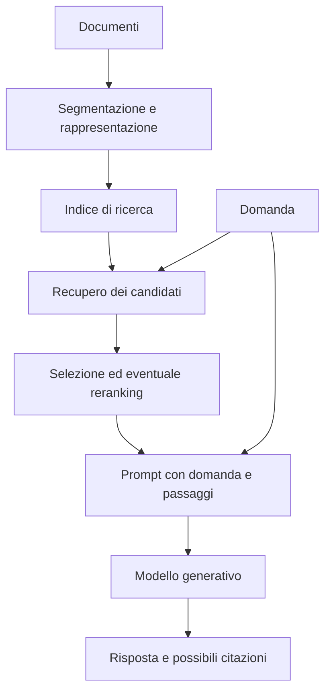

# RAG

Capitolo: [[Comprensione del linguaggio, chatbot e integrazione della conoscenza]].

*Retrieval-Augmented Generation*, indica un'organizzazione del sistema nella quale la generazione di una risposta viene sostenuta dal *recupero di informazioni esterne*. Il modello riceve la domanda insieme a documenti o passaggi pertinenti ed utilizza questo contesto per formulare la risposta. Il problema affrontato è la distanza fra la capacità di produrre testo plausibile e la disponibilità di informazioni corrette, aggiornate o specifiche di un dominio.

Un modello linguistico può infatti rispondere in modo fluido senza disporre del documento necessario. Il RAG rende consultabile un archivio al momento della richiesta: la risposta può dipendere da informazioni recuperate in quel momento, senza richiedere che ogni aggiornamento dell'archivio venga incorporato nei parametri del modello. Si collega così al problema della [[Comprensione del linguaggio e integrazione della conoscenza|integrazione della conoscenza]] ed alla gestione delle [[Allucinazioni dei modelli linguistici]].

## Preparare i documenti perché siano recuperabili

Il recupero richiede una rappresentazione interrogabile dell'archivio. Nella ricerca semantica densa, testi e domande vengono trasformati in embedding, cioè vettori costruiti per rendere utili i confronti numerici. I vettori dei documenti vengono *indicizzati*; quando arriva una domanda, il sistema ne calcola una rappresentazione compatibile e cerca i passaggi più vicini o più simili. L'archivio vettoriale aiuta quindi a individuare contenuti candidati, mentre il testo corrispondente deve rimanere disponibile per essere fornito al generatore.

Un documento lungo può contenere molte informazioni diverse, che un unico vettore rischia di rappresentare in modo troppo compresso. La segmentazione, o **chunking**, divide il testo in unità più piccole, ciascuna dotata della propria rappresentazione. Una ricerca può così individuare il passaggio nel quale si trova un dettaglio, anziché recuperare il documento soltanto in base al suo argomento generale.

*La dimensione dei segmenti è una scelta significativa*. Una frase isolata può perdere il riferimento al soggetto o alle condizioni descritte poco prima; un blocco molto lungo può mescolare informazioni pertinenti e irrilevanti. Titoli, contesto circostante e sovrapposizione fra segmenti possono preservare collegamenti utili. Il chunking documentale riguarda quindi come rendere recuperabile il testo; è distinto dal chunking di [[SOAR Cognitive Architecture|SOAR]], che costruisce nuove regole procedurali.

## Selezionare le informazioni per la domanda corrente

**La domanda orienta la ricerca.** La vicinanza fra embedding può permettere di trovare un passaggio pertinente anche quando non ripete le stesse parole della richiesta, ma non garantisce che contenga la risposta. La qualità del confronto dipende quindi dal modello di rappresentazione e dal dominio: un modello poco adatto ai testi utilizzati può recuperare contenuti genericamente affini ma insufficienti.

La ricerca lessicale offre una risorsa complementare, soprattutto quando conta una corrispondenza precisa, come un nome o un'espressione specifica. Un sistema ibrido combina criteri lessicali e semantici per costruire i candidati. La scelta riguarda quali informazioni recuperare, non la formulazione finale della risposta.

Un ulteriore passaggio è il **reranking**. Il primo recupero seleziona un insieme di **candidati**; un modello successivo valuta la **rilevanza** di ciascuno rispetto alla domanda e ne modifica l'ordine. Un cross-encoder può esaminare insieme domanda e documento prima di assegnare il punteggio, invece di confrontare soltanto due rappresentazioni già calcolate separatamente. Il riordino permette di affinare la selezione iniziale, ma lavora sui candidati ricevuti: se un passaggio necessario è stato escluso prima, non può renderlo disponibile da solo.

## Dal recupero alla generazione ancorata ai documenti

La fase generativa riceve la domanda e i testi selezionati all'interno di un prompt. Le istruzioni specificano come usare quel materiale; il modello produce poi una risposta che dovrebbe rimanere sostenuta dalle evidenze fornite. Questo collegamento prende il nome di **grounded generation**. Ricerca e generazione svolgono quindi funzioni distinte: la prima rende disponibili informazioni, la seconda le elabora in una risposta.

Lo schema sintetizza le due fasi, distinguendo la preparazione dell'archivio dall'elaborazione della domanda:

Come esempio esplicativo, consideriamo un archivio di manuali tecnici. Alla domanda su una procedura di riavvio, il sistema cerca i passaggi del manuale del dispositivo pertinente, li presenta al generatore e gli chiede di ricostruire la procedura. Una risposta affidabile deve rispettare le condizioni specificate, come il modello del dispositivo o eventuali prerequisiti. Trovare una procedura simile per un altro dispositivo non basta a giustificarne l'applicazione.

Le citazioni possono rendere controllabile il collegamento fra risposta e passaggi recuperati. Devono però sostenere le affermazioni alle quali sono associate: citare un documento pertinente all'argomento non dimostra che esso contenga ogni dettaglio generato. Una [[Argomentazione e spiegazione|giustificazione]] controllabile richiede di verificare che il documento sostenga davvero la conclusione.

## Quando una sola ricerca non basta

In una conversazione, una richiesta può contenere riferimenti impliciti. La **query rewriting** riscrive la domanda rendendo esplicita l'esigenza informativa, per esempio collegando «e nell'altro anno?» all'argomento discusso in precedenza. Serve a migliorare il recupero mantenendo il significato della richiesta, non a sostituirla con una domanda diversa.

Una domanda composta può richiedere più ricerche. Nel **multi-query**, si costruiscono diverse query per raccogliere informazioni complementari; nel multi-hop, le ricerche hanno una dipendenza sequenziale, perché un risultato determina che cosa cercare dopo. Per confrontare due elementi si possono cercare separatamente le loro proprietà; per trovare informazioni su un'entità non ancora nota, può essere necessario identificarla prima e poi interrogarne le caratteristiche.

Il routing sceglie la fonte adatta alla richiesta. Un sistema può consultare archivi diversi per informazioni su prodotti o procedure interne. Quando il modello coordina questi passaggi e utilizza le fonti come strumenti, il recupero entra nel ciclo di un agente. Nei [[Chatbot con LLM, RAG e Knowledge Graphs|chatbot]], queste operazioni possono utilizzare anche i messaggi precedenti per ricostruire la richiesta corrente.

I [[Knowledge Graphs]] aggiungono la possibilità di recuperare informazioni attraverso entità e relazioni esplicite. Un approccio GraphRAG può essere utile quando la domanda richiede di collegare più fatti, ma dipende dalla qualità del grafo e dal significato delle relazioni. La struttura del grafo non certifica da sola la verità della conclusione.

## Limiti e valutazione

Gli errori possono nascere in punti diversi. La segmentazione può separare informazioni necessarie; il recupero può selezionare passaggi sbagliati o omettere quelli decisivi; il generatore può interpretare male un testo corretto o aggiungere dettagli non supportati. Aumentare il numero di passaggi non risolve automaticamente questi problemi, perché può introdurre rumore e consumare spazio nel contesto.

La valutazione deve perciò distinguere la rilevanza dei documenti dalla qualità della risposta. La fedeltà al contesto verifica se la risposta è coerente con i passaggi forniti; la rilevanza della risposta riguarda il rapporto con la domanda; il supporto delle citazioni controlla il legame fra affermazioni e documenti. Queste [[Metriche di valutazione dei Foundation Models|dimensioni di valutazione]] devono rimanere distinte dalla sola fluidità del testo.

Il confronto con [[CAG]] chiarisce infine una scelta architetturale: il RAG seleziona informazioni in funzione della domanda, mentre il CAG precarica un insieme delimitato di documenti e ne riutilizza lo stato di elaborazione. La convenienza dipende dalla quantità di conoscenza da rendere disponibile e dalle caratteristiche delle richieste. Entrambi richiedono un controllo della corrispondenza fra evidenze e risposta.
