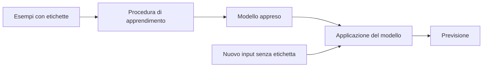

---
tags:
  - ragionamento
  - induzione
  - apprendimento
  - generalizzare
---

Capitolo: [[Ragionamento, inferenza causale e spiegazione]]

Il **ragionamento induttivo** consiste nel generalizzare dai casi osservati a casi non ancora osservati. A partire da una regolarità riscontrata nell'esperienza, il sistema formula una conclusione che si estende oltre gli esempi disponibili. Proprio questa estensione rende l'induzione utile per apprendere e prevedere, ma impedisce di attribuirle la garanzia logica propria della deduzione.

## Dalle osservazioni alla generalizzazione

Tutti gli elefanti che abbiamo osservato hanno la proboscide; da questa esperienza passiamo all'affermazione che tutti gli elefanti hanno la proboscide. Le premesse riguardano gli esemplari effettivamente osservati, mentre la conclusione riguarda anche quelli mai incontrati.

Il passaggio fondamentale non è quindi il semplice riassunto delle osservazioni. Dire che tutti gli elefanti del campione osservato hanno una certa proprietà resta una descrizione del campione. Affermare che la stessa proprietà appartiene a ogni elefante è invece una **generalizzazione**. La conclusione potrebbe risultare vera, ma *la sola enumerazione di un numero finito di casi favorevoli non ne costituisce una dimostrazione universale*.

Come formalizzazione didattica dell'esempio:
Siano $a_1,\ldots,a_n$ gli elefanti osservati e $T$ la proprietà «avere la proboscide». Le osservazioni $T(a_1),\ldots,T(a_n)$ sostengono l'ipotesi generale «ogni elefante ha la proprietà $T$».

Non la implicano con la stessa necessità con cui due premesse di un'inferenza deduttiva valida implicano la conclusione. L'assenza di un controesempio nel campione non equivale all'impossibilità di un controesempio fuori da esso.

## Perché l'induzione non offre una prova definitiva

L'induzione non permette di provare definitivamente vera una generalizzazione, ma permette di falsificarla. Il riferimento va inteso nel contesto della generalizzazione universale appena proposta: molti esempi favorevoli non escludono ogni eccezione, mentre un caso autentico incompatibile con l'enunciato universale è sufficiente a smentirlo.

Occorre precisare il campo di questa osservazione. Un'affermazione come «tutti gli elementi di una categoria hanno la proprietà $T$» esclude ogni eccezione. Un'affermazione probabilistica come «la proprietà $T$ è frequente in questa categoria» ammette invece casi privi di $T$. Un singolo caso contrario non ha lo stesso effetto sulle due affermazioni. Questa distinzione serve a non trasformare la formulazione sintetica in una regola indiscriminata su qualsiasi ipotesi statistica.

Il limite dell'induzione non è dunque un divieto di generalizzare. Significa che la conclusione deve conservare lo statuto di ipotesi sostenuta dall'esperienza e rivedibile quando arrivano nuove evidenze. Nonostante l'assenza di una garanzia definitiva, l'induzione rimane molto utile.

## Origine empirica della conoscenza

Nel quadro dell'empirismo, la conoscenza ha origine nell'esperienza sensoriale. Il principio induttivo, legato alla riflessione di Hume, riguarda l'acquisizione di regole generali attraverso l'esposizione ripetuta ad associazioni fra i loro elementi: osservare più volte una certa relazione porta ad aspettarsi che essa si ripresenti anche in situazioni nuove.

Il punto rilevante per l'IA è che non tutta la conoscenza deve essere scritta a mano dal progettista. Il sistema può *acquisire regolarità attraverso l'esperienza*. Questo non rende irrilevanti la rappresentazione iniziale e le scelte progettuali: esse determinano quali dati siano disponibili e quali caratteristiche possano essere utilizzate per individuare regolarità.

L'apprendimento è definito come il miglioramento delle prestazioni nel tempo attraverso l'acquisizione di conoscenze o abilità. 
Si distingue apprendimento **supervisionato**, **non supervisionato** e per **rinforzo**. Il rapporto con l'induzione è concettuale: quando un comportamento appreso viene applicato a situazioni non ancora incontrate, il sistema deve trasferire qualcosa oltre gli episodi già sperimentati. Questo collegamento non significa che ogni meccanismo di apprendimento coincida con la semplice formulazione di una regola universale.

## Generalizzazione nei modelli appresi

Nell'apprendimento supervisionato, ogni esempio di addestramento associa un input al risultato corretto, detto etichetta: per esempio, un'immagine alla categoria dell'oggetto rappresentato. La procedura di apprendimento utilizza queste coppie per costruire un modello capace di associare input e risultati. Nella fase successiva, il modello riceve nuovi input senza la relativa etichetta e produce una previsione.

La generalizzazione consiste nel riuscire a trattare correttamente anche gli input non incontrati durante l'addestramento. Riprodurre le etichette degli esempi già disponibili non basta quindi a dimostrare che il modello abbia appreso una regolarità utile per casi nuovi.

Un esempio concreto è il ragionamento k-NN. Il metodo mantiene gli esempi disponibili e, per un nuovo elemento, utilizza quelli più vicini nello spazio delle caratteristiche. La previsione per il nuovo elemento è un'estensione oltre i dati noti, pur senza richiedere una regola simbolica universale esplicita. Questo approccio è chiamato *instance-based* o *memory-based learning*.

La generalizzazione dipende però dalla rappresentazione adottata. Sono determinanti la scelta delle caratteristiche, delle distanze e della normalizzazione: se una caratteristica numerica ha una scala molto più ampia delle altre, può dominare il confronto. Anche il numero $k$ dei vicini cambia il comportamento del metodo e viene scelto mediante validazione incrociata. Queste scelte mostrano che «imparare dai dati» richiede una struttura di confronto, non soltanto la presenza di molti esempi.

I metodi di vicinato incontrano inoltre difficoltà in alta dimensionalità: i vicini possono non essere sufficientemente vicini e possono mancare esempi localmente informativi. Non basta quindi contare le osservazioni; occorre considerare in quale spazio esse siano distribuite e quanto siano pertinenti per il nuovo caso.

## Induzione, deduzione e ragionamento per casi

Il [[Ragionamento deduttivo]] applica premesse e regole per ricavare una conseguenza necessaria. L'induzione usa i casi disponibili per sostenere un'estensione a casi non osservati. Nel [[Ragionamento basato su casi]] l'esperienza precedente può essere riutilizzata direttamente, mantenendo il riferimento a episodi o istanze specifiche anziché condensarla subito in una legge generale.

La distinzione non implica che i processi non possano cooperare. In [[SOAR Cognitive Architecture | SOAR]], un episodio precedente può contribuire alla risoluzione di un impasse e alla costruzione di una nuova regola tramite *chunking*. La registrazione episodica è invece un meccanismo passivo: conserva l'esperienza senza generalizzarla di per sé. Per modificare il comportamento futuro occorre che l'episodio venga recuperato ed elaborato.

## Che cosa bisogna controllare in una conclusione induttiva

Per valutare una generalizzazione bisogna rendere espliciti i casi osservati, la proprietà individuata e l'estensione della conclusione. Va poi distinto ciò che è stato effettivamente misurato da ciò che si ipotizza sui casi nuovi. Nei metodi basati sulla somiglianza occorre chiarire che cosa renda due elementi simili e perché quella somiglianza sia utile per il compito.

La conclusione induttiva non diventa una deduzione soltanto perché viene espressa con sicurezza o prodotta da un modello complesso. La sua forza rimane legata alle evidenze e alle condizioni nelle quali vengono utilizzate. Questa è anche la ragione per cui l'induzione si collega al [[Ragionamento in condizioni di incertezza]]: occorre ragionare su conclusioni che possono essere utili senza essere logicamente garantite.
