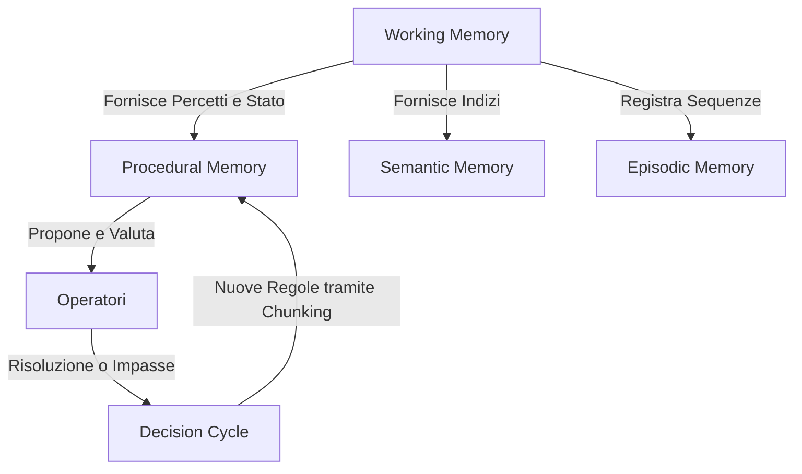
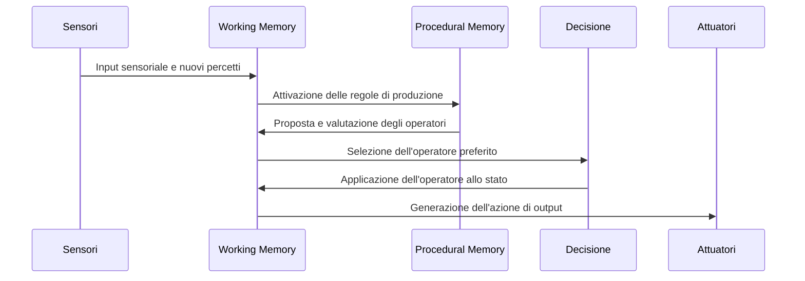

---
tags:
  - architetture-cognitive
  - sistemi-simbolici
  - memorie
  - ragionare
---
Il modello **SOAR** rappresenta l'architettura cognitiva simbolo del paradigma cognitivista e simbolico dell'Intelligenza Artificiale. Sviluppata a partire dal 1987 da Allen Newell, John Laird e Paul Rosenbloom presso l'Università del Michigan e la Carnegie Mellon University, SOAR nasce con l'obiettivo di realizzare una *teoria unificata della cognizione*, capace di integrare in un singolo sistema computazionale il ragionamento, la risoluzione dei problemi, la memoria e l'apprendimento automatico.

## Inquadramento Teorico nel Paradigma Cognitivista

SOAR fonda le sue radici teoriche sull'ipotesi dei sistemi di simboli fisici enunciata da Newell e Herbert Simon nel 1976. Secondo questo approccio, la mente umana opera manipolando simboli astratti attraverso regole esplicite disincarnate. A differenza dei sistemi esperti tradizionali guidati da una singola euristica rigida, SOAR è progettata per gestire problemi complessi e aperti attraverso un'organizzazione modulare della conoscenza e un meccanismo di controllo dinamico basato sugli stati del mondo.

L'architettura trova la sua formalizzazione completa nell'opera di Allen Newell del 1990 (*Unified Theories of Cognition*), dove viene definita come un framework unificato per la modellazione dell'intelligenza artificiale ed umana.

## Architettura della Memoria

La memoria di SOAR è strutturata in due macro-componenti fondamentali che separano lo stato a breve termine dalle conoscenze permanenti a lungo termine.

- **Short-Term Memory**
  Conserva una rappresentazione orientata agli oggetti e agli attributi dello stato attuale del mondo, integrando sia i percetti forniti dall'esterno sia gli stati mentali intermedi generati dal ragionamento dell'agente.
- **Long-Term Memory**
  La memoria a lungo termine si suddivide in tre moduli distinti per struttura e funzione:
	- **Procedural Memory**
	  Contiene la conoscenza operativa memorizzata sotto forma di regole di produzione della struttura condizione-azione. Queste regole definiscono quando e come proporre, confrontare ed applicare gli operatori.
	- **Semantic Memory**
	  Conserva la conoscenza dichiarativa astratta e concettuale sul mondo, indipendente dal momento e dal luogo in cui è stata apprea.
	- **Episodic Memory**
	  Registra la cronologia temporale automatica delle esperienze passate vissute dall'agente, mantenendo traccia degli stati della Working Memory legati agli specifici contesti temporali.

## Il Ciclo Decisionale

Il programma dell'agente SOAR lavora attraverso l'esecuzione iterativa di un ciclo decisionale articolato in fasi sequenziali.

1. Fase di Elaborazione Input
   I sensori convertono le informazioni ambientali in elementi simbolici caricati direttamente nella Working Memory.

2. Fase di Proposta e Confronto
   Tutte le regole della memoria procedurale le cui condizioni soddisfano lo stato della Working Memory vengono attivate in parallelo. Queste regole propongono possibili operatori da applicare e creano preferenze numeriche o simboliche per valutarli.

3. Fase Decisionale
   La procedura decisionale analizza l'insieme delle preferenze generate. Se esiste un singolo operatore nettamente preferito, esso viene selezionato ed applicato per modificare lo stato della Working Memory.

4. Fase di Esecuzione Output
   I cambiamenti apportati alla Working Memory generano i comandi per gli attuatori ed eseguono le azioni sull'ambiente esterno.

## Risoluzione degli Impasse ed Apprendimento per Chunking

Durante la fase decisionale può accadere che la memoria procedurale non fornisca indicazioni sufficienti. Questa situazione viene definita Impasse e si verifica quando l'agente non propone alcun operatore oppure quando propone più operatori in conflitto senza stabilire una preferenza netta.

Quando si presenta un impasse, SOAR crea automaticamente uno sotto-obiettivo per risolvere la stasi. L'agente sospende temporaneamente il compito principale e tenta di risolvere il sotto-obiettivo ricorrendo alle altre forme di memoria a lungo termine:

- **Consultazione Episodica e Semantica**
  L'agente cerca nelle esperienze passate memorizzate nella memoria episodica o nei fatti della memoria semantica una sequenza di scelte che consenta di superare l'incertezza.

- **Meccanismo di Chunking**
  Una volta risolto il sotto-obiettivo, l'architettura sintetizza il processo di risoluzione creando automaticamente una nuova regola nella memoria procedurale. Questo processo di apprendimento permanente permette all'agente di memorizzare la soluzione trovata; nelle successive situazioni analoghe, la nuova regola si attiverà immediatamente evitando l'impasse.

Oltre al Chunking, le versioni moderne di SOAR integrano meccanismi di apprendimento per rinforzo per ottimizzare il valore numerico delle preferenze degli operatori e meccanismi di apprendimento semantico per assimilare nuovi concetti dichiarativi.

## Dai Modelli Classici alle Architetture per Agenti basati su LLM

L'architettura SOAR rappresenta il ponte concettuale che collega l'IA simbolica tradizionale agli agenti cognitivi contemporanei.

Il quadro concettuale [[CoALA]] riprende l'organizzazione in memoria di lavoro e memorie a lungo termine per descrivere gli agenti basati su modelli di linguaggio. Distingue memoria semantica, episodica e procedurale; in quest'ultima comprende sia i parametri del modello sia il codice dell'agente. Come SOAR, CoALA coordina memoria, ragionamento, apprendimento e scelta dell'azione. I meccanismi restano distinti: una riflessione linguistica non coincide automaticamente con la gestione degli impasse, né il salvataggio di un'esperienza con il chunking.
