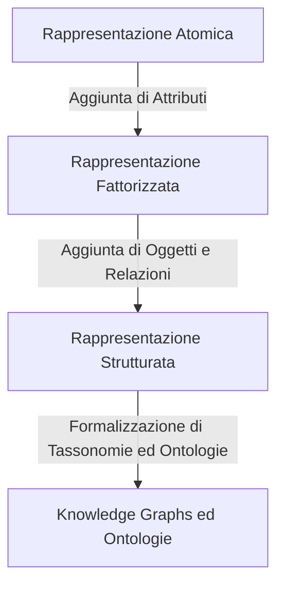
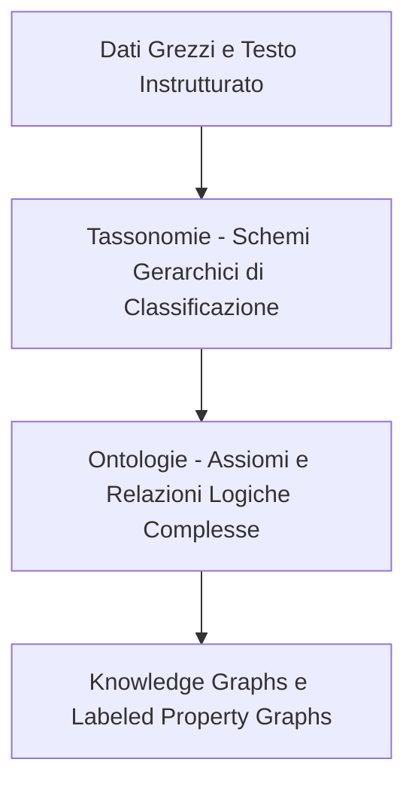

Il problema della **rappresentazione della conoscenza** costituisce uno dei pilastri storici e concettuali dell'Intelligenza Artificiale. Come evidenziato fin dai test fondativi di Alan Turing del 1950 e dai primi lavori di John McCarthy sull'Advice Taker nel 1958, un [[Agente Razionale|agente razionale]] necessita di una struttura interna per memorizzare ciò che conosce o percepisce dell'ambiente, al fine di guidare le proprie decisioni, risolvere problemi e trarre nuove conclusioni logiche.

La sfida fondamentale della **Knowledge Representation** consiste nel progettare formalismi computazionali che siano al tempo stesso **sufficientemente espressivi** da catturare la complessità del mondo reale e **sufficientemente efficienti** da consentire un ragionamento automatizzato in tempi utili.

## Lo Spettro dei Livelli di Espressività della Conoscenza

Le rappresentazioni dell'ambiente vengono classificate lungo un asse di complessità ed espressività crescente.

- **Rappresentazione Atomica**
  Ogni stato del mondo è trattato come una scatola nera indivisibile priva di struttura interna. L'unica proprietà rilevabile è l'identità o la diversità rispetto ad un altro stato. È il formalismo alla base degli algoritmi classici di ricerca su grafi, delle [[Hidden Markov Models |Catene di Markov Nascoste]] e dei [[Markov Decision Processes |Processi Decisionali di Markov]].

- **Rappresentazione Fattorizzata**
  Ogni stato viene suddiviso in un insieme fisso di **variabili** o attributi, ciascuno avente un valore specifico. Due stati distinti possono condividere alcuni attributi e differire per altri. È alla base della logica proposizionale, dei problemi di soddisfacimento di vincoli, delle reti bayesiane e dell'apprendimento automatico vettoriale.

- **Rappresentazione Strutturata**
  Il mondo viene descritto in termini di **oggetti espliciti**, attributi individuali e relazioni complesse che intercorrono tra gli oggetti. Consente di esprimere proposizioni arricchite ed è il formalismo adottato dalla *logica di primo ordine* e dai *grafi della conoscenza*.

- **Grafi della Conoscenza ed Ontologie**
  Rappresentano l'evoluzione ed il massimo livello di espressività della conoscenza strutturata. Introducono classi gerarchiche, assiomi logici formali e reti di proprietà relazionali orientate agli oggetti (*Labeled Property Graphs*), consentendo il ragionamento distribuito ed il recupero semantico complesso.

## Conoscenza Procedurale e Dichiarativa nelle Architetture Cognitive

Nelle architetture cognitive complete come [[SOAR Cognitive Architecture|SOAR]], il problema della rappresentazione si articola nella distinzione tra **conoscenza operativa** e **conoscenza dichiarativa**.

- **Conoscenza Operativa o Procedurale**
  Memorizzata sotto forma di regole di produzione della struttura condizione-azione. Rappresenta il sapere pratico su come eseguire compiti e selezionare gli *operatori di trasformazione dello stato*.

- **Conoscenza Dichiarativa Semantica**
  Conserva concetti astratti, fatti e relazioni indipendenti dal momento dell'apprendimento, organizzati in reti concettuali ed ontologie.

- **Conoscenza Dichiarativa Episodica**
  Rappresenta le esperienze passate contestualizzate nel tempo e nello spazio, fornendo la memoria autobiografica dell'agente.

## Grafi della Conoscenza, Tassonomie ed Ontologie

La rappresentazione esplicita della conoscenza strutturata trova la sua forma più moderna negli Knoledge Graphs.

- **Tassonomie**
  Forniscono schemi di classificazione gerarchica basati su relazioni di sotto-classe, consentendo di organizzare i concetti dal più generale al più specifico. 
  Possiamo organizzare ad esmepio le categorie secondo le relazioni $\text{Studente magistrale}\subseteq\text{Studente}\subseteq\text{Persona}$ e $\text{Docente}\subseteq\text{Persona}$. Ogni studente magistrale è quindi anche uno studente e una persona; non ogni persona è uno studente magistrale. La relazione esprime «è un tipo di», non «è una parte di»: un dipartimento fa parte di un'università, ma non è un tipo di università.

  Le categorie vanno distinte dai singoli individui: **Studente è una classe; Luca è un individuo che può appartenere a quella classe**. La tassonomia *descrive la gerarchia delle classi*, non stabilisce da sola quali corsi frequenti Luca.

- **Ontologie**
  Estendono le tassonomie definendo assiomi formalizzati, vincoli di dominio e tipi di relazioni trasversali tra categorie. Un'ontologia agisce come un contratto concettuale per condividere la conoscenza tra sistemi diversi.
  
- Oltre alle classi Persona, Studente e Docente, si introducono la classe Corso e la relazione frequenta. Possiamo formalizzare gli assiomi «ogni studente è una persona» e «se qualcuno frequenta qualcosa, il primo è uno studente e il secondo è un corso»:

  $$
  \begin{aligned}
  \operatorname{Studente}(x)&\Rightarrow\operatorname{Persona}(x),\\
  \operatorname{frequenta}(x,y)&\Rightarrow
  \operatorname{Studente}(x)\land\operatorname{Corso}(y).
  \end{aligned}
  $$

  Aggiungendo il fatto «Luca frequenta Cognitive Computing», queste regole permettono di dedurre che **Luca è uno studente e quindi una persona**, e che Cognitive Computing è un corso. L'ontologia specifica così anche il *significato* delle relazioni e le *conseguenze* dei fatti, oltre alla classificazione gerarchica. I nomi e le regole dell'esempio sono scelte di modellazione per il dominio considerato.

- **Labeled Property Graphs**
  Modello usato da database a grafo come Neo4j. La conoscenza viene rappresentata tramite nodi che indicano entità, archi etichettati che indicano relazioni dirette e coppie chiave-valore di proprietà collegate a nodi ed archi.

  Si rappresenta quindi *Luca* mediante un nodo con etichetta `Studente` e proprietà `nome: "Luca"`, e *Cognitive Computing* mediante un nodo con etichetta `Corso` e proprietà `titolo: "Cognitive Computing"`, un'arco `FREQUENTA` collega Luca al corso; sull'arco si memorizza la proprietà `anno_accademico: "2026/27"`.

  La distinzione è utile: il nome descrive il nodo della persona, mentre l'anno accademico descrive la sua specifica iscrizione al corso. Luca potrebbe frequentare un altro corso in un anno differente senza cambiare identità.

  **In questo esempio, il grafo rappresenta il fatto concreto «Luca frequenta Cognitive Computing nell'anno accademico 2026/27»**. La tassonomia descrive invece la gerarchia delle categorie, come «Studente è una sottoclasse di Persona»; l'ontologia aggiunge il significato formale delle relazioni e gli assiomi con cui dedurre nuove informazioni. Questi strumenti possono essere usati insieme: il grafo può contenere i dati sui singoli studenti e corsi, mentre l'ontologia ne definisce i concetti e le relazioni.

| Strumento              | Esempio                                                                               | Informazione messa in evidenza                             |
| :--------------------- | :------------------------------------------------------------------------------------ | :--------------------------------------------------------- |
| Tassonomia             | Studente è una sottoclasse di Persona.                                                | Gerarchia fra categorie.                                   |
| Ontologia              | Chi frequenta un corso è uno studente; ogni studente è una persona.                   | Significato formale delle relazioni e regole di inferenza. |
| Labeled Property Graph | Luca è collegato a Cognitive Computing da `FREQUENTA`, con anno accademico sull'arco. | Entità concrete, relazioni e proprietà.                    |

## La Rappresentazione della Conoscenza nell'Era dei Grandi Modelli di Linguaggio

L'avvento dei grandi modelli di linguaggio ha introdotto una fondamentale distinzione tra rappresentazione *implicita* ed *esplicita* della conoscenza.

I modelli di linguaggio contengono una conoscenza implicita o parametrica memorizzata all'interno dei pesi sinaptici durante il pre-addestramento. Sebbene questa rappresentazione consenta una notevole flessibilità generativa, essa soffre di allucinazioni e di opacità interpretativa.

Per superare queste limitazioni, l'IA Agentica moderna integra i grafi della conoscenza ed il **[[RAG]]** 
(*Retrieval-Augmented Generation*) nella metodologia denominata **GraphRAG**. In questa architettura ibrida, la conoscenza esplicita del grafo viene recuperata per strutturare i contesti di prompt del modello di linguaggio. Questo approccio unisce l'espressività della rappresentazione simbolica strutturata alla capacità di ragionamento fluido dei modelli generativi, rendendo più espliciti i collegamenti fra entità ed evidenze. Può sostenere ragionamenti a più passaggi e ridurre alcune risposte non supportate, ma non garantisce accuratezza né elimina automaticamente le allucinazioni: occorre verificare il grafo, il recupero e l'uso delle informazioni nella risposta.
